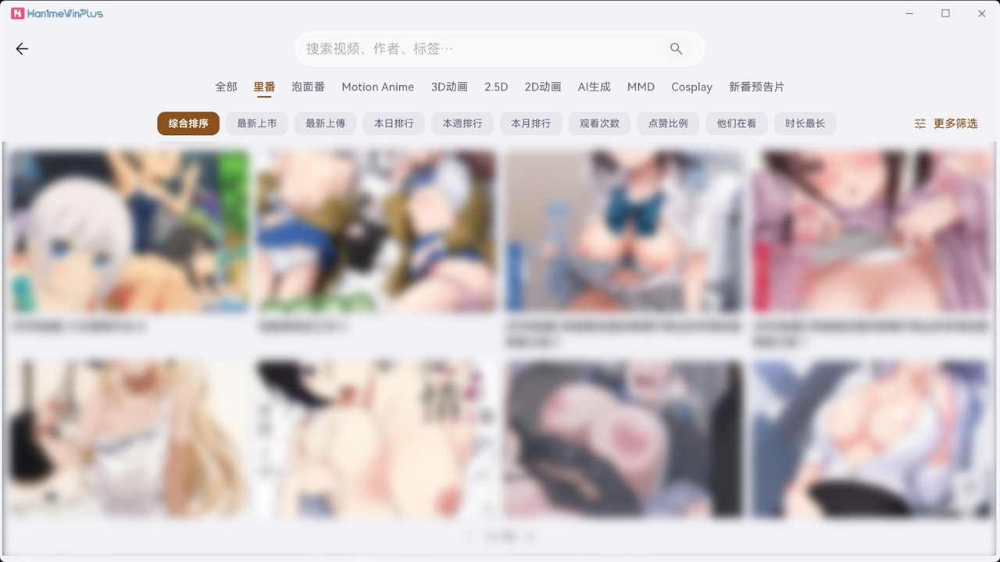
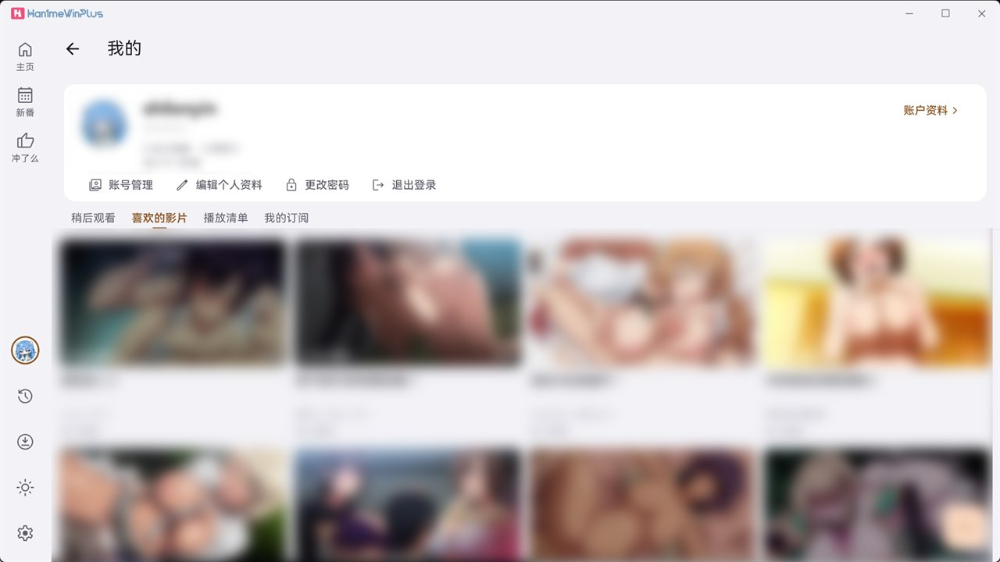
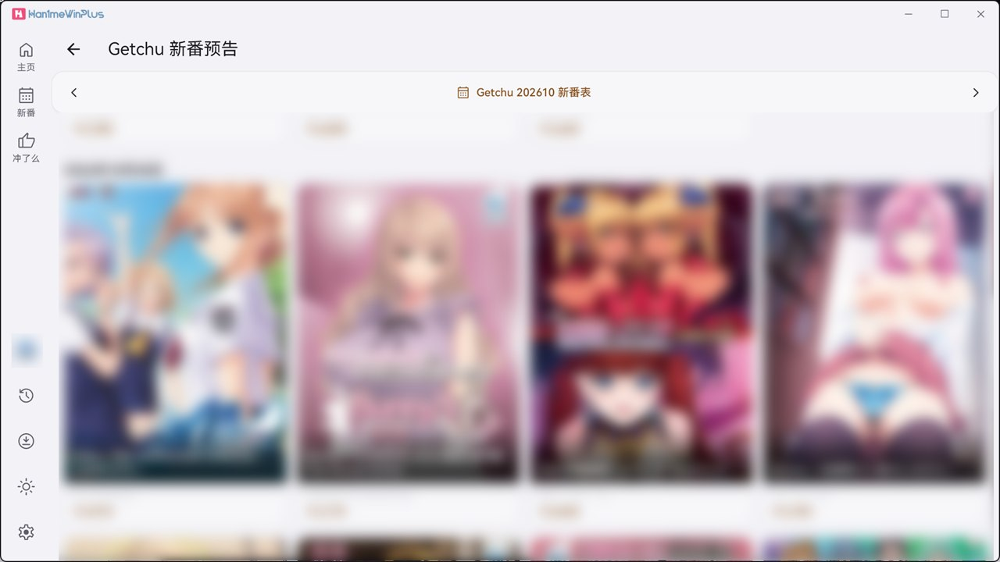
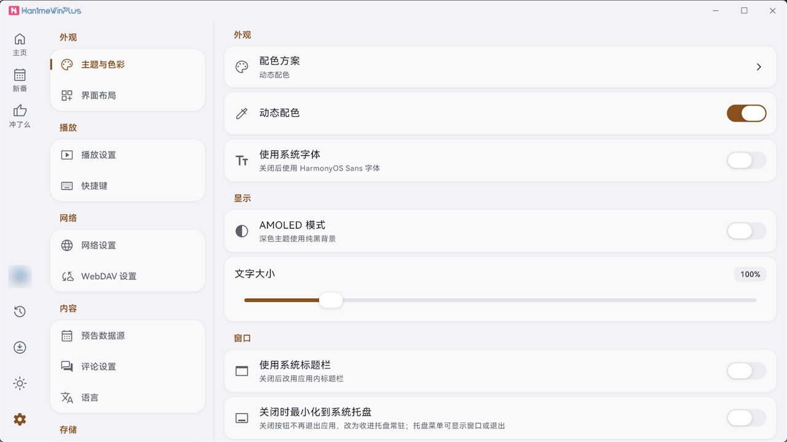
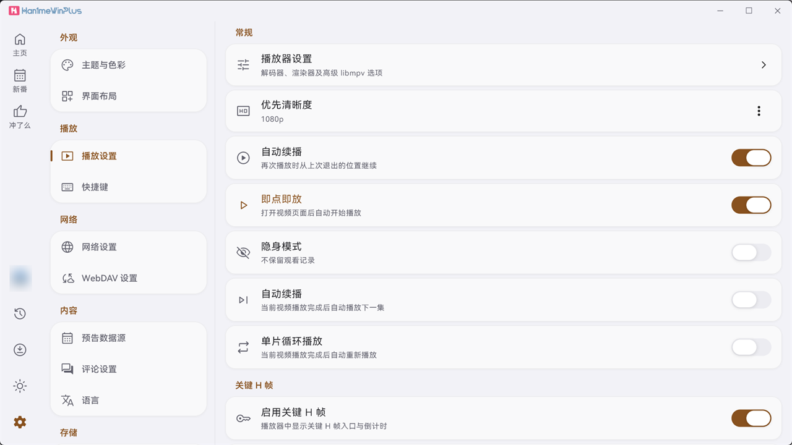
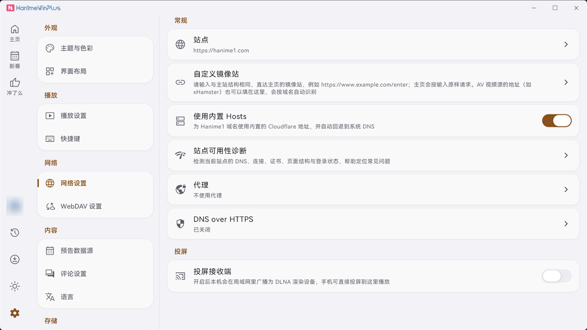
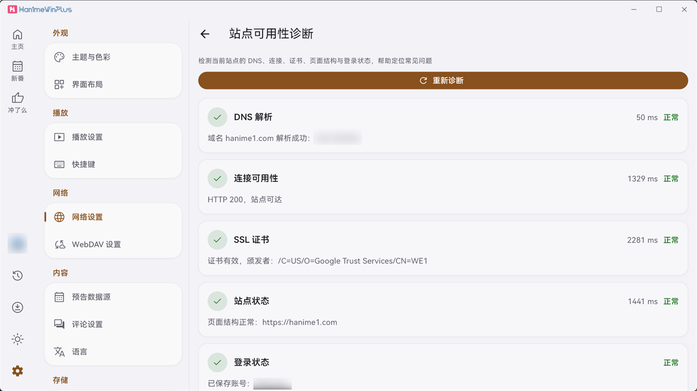

# Han1meWinPlus

<p align="center">
  <b>English</b> · <a href="README.md">简体中文</a>
</p>

<p align="center">
  
</p>

<p align="center">
  <b>A Hanime1 client built for Windows 10 / 11</b><br>
  Hardware decoding · Super-resolution · Installer + portable build · Built-in updater<br>
  <sub>Built with Flutter and Material Design 3 · based on Han1mePlus</sub>
</p>

<p align="center">
  
  
  
</p>

<p align="center">
  <a href="https://github.com/shilonyin/Han1meWinPlus/actions/workflows/build-windows.yml"></a>
  <a href="https://github.com/shilonyin/Han1meWinPlus/releases/latest"></a>
  <a href="https://github.com/shilonyin/Han1meWinPlus/releases"></a>
  <a href="https://github.com/shilonyin/Han1meWinPlus/stargazers"></a>
</p>

<p align="center">
  <b>Ready to download and install on Windows 10 / 11</b><br>
  <a href="../../releases/latest">Download latest</a> · <a href="../../issues/new/choose">Report an issue</a> · <a href="../../releases">Changelog</a> · <a href="../../discussions">Discussions</a>
</p>


## About

Han1meWinPlus is a Windows client whose base code comes from [Han1mePlus](https://github.com/1wc10086/Han1mePlus), built with Flutter and Material Design 3.

The project concentrates on the Windows side: window behaviour, the player, the installer and the update flow. The `android` / `ios` / `macos` / `linux` directories come from Han1mePlus and are kept for reference only — they are neither maintained here nor guaranteed to build or work.

> This project has no affiliation with Hanime1 whatsoever. It is a community-maintained, third-party open-source client.

## Features

- **Windows-specific**: native window and custom title bar, windowed / full-screen switching, multi-monitor and high-DPI support, installer + portable build, in-app updater (with mirror fallback)
- **Player**: libmpv + hardware decoding (d3d11va / dxva2 / nvdec) + several super-resolution modes (Anime4K, EWA Lanczos) + keyframe jumping, buffered-range indicator, playback-position memory
- **Networking**: built-in direct-connect addresses, site diagnostics (DNS / connection / certificate / page structure / sign-in), latency probing with automatic ranking, system proxy / direct / custom proxy, custom mirrors
- **Browsing & search**: home sections, category and tag filters, multi-criteria sorting, search suggestions and search history
- **Local library**: watch later, liked videos, playlists, watch history, offline downloads, subscriptions
- **Interface**: Material Design 3, dynamic color, light / dark / AMOLED, bundled HarmonyOS Sans, UI in Simplified Chinese / Traditional Chinese / English

## Screenshots

| Home (sections) | Search results |
| --- | --- |
|  |  |

| My library (watch later / liked / playlists / subscriptions) | New releases |
| --- | --- |
|  |  |

| Appearance settings | Player settings |
| --- | --- |
|  |  |

| Network settings | Site diagnostics |
| --- | --- |
|  |  |

> Video covers and account information in the screenshots have been blurred. The screenshots show the Simplified Chinese interface; Traditional Chinese and English are also available in-app.

## Project origin

All of the base code comes from [Han1mePlus](https://github.com/1wc10086/Han1mePlus) (AGPL-3.0), and this project is likewise licensed under AGPL v3.0. On top of that, the following work is done for Windows:

- **Window & title bar**: custom title bar, full-screen window, multi-monitor and DPI scaling
- **Player**: hardware-decoder options, super-resolution, proxy passed through to the player
- **Installer**: installer and portable archive shipped with every release
- **Update flow**: in-app update check with mirror fallback

For other platforms, use [Han1mePlus](https://github.com/1wc10086/Han1mePlus).

## Download

### Recommended: the installer

**[Han1meWinPlus-Setup.exe](../../releases/latest)** — single file, Start-menu shortcut, clean uninstall ([direct download](../../releases/latest/download/Han1meWinPlus-Setup.exe))

> Download this one file and double-click it; no companion files are needed.
>
> **The installer is not code-signed**, so Properties → Digital Signatures is empty and
> Windows shows an "Unknown publisher" prompt on first launch. It is planned to use free
> code signing from **SignPath Foundation** (Free code signing provided by
> [SignPath.io](https://about.signpath.io), certificate by
> [SignPath Foundation](https://signpath.org)), but the application was not approved — see
> the [Code signing policy](#code-signing-policy) and
> [Available signing routes](#available-signing-routes).

Portable build: `Han1meWinPlus-windows-x64.zip` — unzip and run `han1me_win_plus.exe` ([direct download](../../releases/latest/download/Han1meWinPlus-windows-x64.zip))

> If an "Unknown publisher" prompt appears on first launch, click "More info → Run anyway"; the portable build skips the installer entirely.

- **System requirements**: Windows 10 (1809 or later) / Windows 11, 64-bit
- **Install privileges**: administrator rights are required by default (installs to `Program Files`). If your account is a plain standard user (not in the Administrators group), pass `/CURRENTUSER` to install per-user without elevation: `Han1meWinPlus-Setup.exe /CURRENTUSER`
- **Verifying your download**: each release ships `SHA256SUMS.txt` (also included in the release notes); check it in PowerShell with `certutil -hashfile <file> SHA256`
- **Data directory**: `%APPDATA%\han1me_win_plus\`. It survives reinstalling and upgrading. On uninstall you are asked whether to remove app data (settings and history, web cache and sign-in state); **downloaded videos are asked about separately and kept by default**
- **Upgrading**: when you are on an older version the app shows an update prompt automatically, and you can also check manually under Settings → About

All previous versions and their changelogs are on the [Releases](../../releases) page.

## Project status

- **Windows**: maintained, features are still being refined
- **Android / iOS / macOS / Linux**: not maintained; the code in those directories comes from Han1mePlus and is kept for reference only

Known limitations (stated up front so expectations are clear):

- Only Windows is maintained; other platforms are not guaranteed to compile or work
- Image CDNs of some sources are slow; the first paint of covers may take a moment before the local cache kicks in
- There is no automated test coverage for all features — the only unit tests in the repository cover update checking

## FAQ

<details>
<summary>Windows says "Unknown publisher" or an antivirus blocks the app on first launch</summary>

The installer is not code-signed yet (the free signing application was not approved; other routes are in [docs/code-signing.md](docs/code-signing.md)), so this is the normal prompt for unsigned software. Click "More info" → "Run anyway", or download the portable archive and run it directly.

</details>

<details>
<summary>The in-app update check fails or is very slow</summary>

Update checks go through GitHub Releases and may time out on restricted networks. "Automatically use an update mirror" under Settings → About tries mirrors in turn when the direct connection fails; you can also download the installer manually from the Releases page of this repository.

</details>

<details>
<summary>How does this project relate to Han1mePlus?</summary>

All of the base code comes from Han1mePlus; the Windows window, player, installer and update flow are maintained separately in this repository, and every release ships ready-to-install artifacts. See "Project origin" above.

</details>

<details>
<summary>Will uninstalling delete my data? Will updating keep it?</summary>

No. Everything lives in `%APPDATA%\han1me_win_plus\` (account, subscriptions, watch history, liked videos, playlists). Reinstalling and upgrading leave it untouched, and uninstalling does not remove it; delete that folder manually if you want to wipe everything.

</details>

<details>
<summary>Hardware decoding does not work, or playback shows artifacts / a black screen</summary>

Settings → Playback settings has a hardware-decoding switch plus a decoder picker, defaulting to `auto-safe`. If you see artifacts, a green screen or a black screen:

1. Switch the decoder to `d3d11va-copy` or `dxva2-copy` (copy modes are more compatible, at the cost of one extra memory copy)
2. If it is still broken, turn hardware decoding off and use software decoding (heavier on the CPU, but the most compatible)

If a particular decoder works noticeably better on your GPU, a report with your GPU model and driver version is welcome.

</details>

<details>
<summary>How do I configure a proxy or a mirror?</summary>

Both live under Settings → Network settings:

- **Proxy**: follow the system / direct / custom address (`host:port`). Once saved, UI requests and the player (libmpv) use the same proxy
- **Site**: switch the video source; the "Site groups" entry at the bottom of the picker lets you rename and reorder groups
- **Custom mirror**: enter a mirror address and use "Test connection" to verify that it resolves

</details>

<details>
<summary>The sidebar disappears when the window gets narrow</summary>

That is intended: when the shortest side of the window drops below 600 logical pixels the layout switches to a compact one and the sidebar collapses into a drawer. Widen the window to get it back.
If the window is misplaced or does not restore after leaving full screen, update to the latest version first (these cases were fixed recently); if it persists, open an issue with a screenshot.

</details>

## Build from source

> **Flutter ≥ 3.47.0 is required** (a constraint from `m3e_core: ^1.1.1`), and `.fvmrc` pins `3.47.4`. Building with the same version is recommended. With an older Flutter, `flutter pub get` fails to resolve dependencies — this is unrelated to the application code.

```bash
flutter pub get
flutter build windows --release
```

Building the Windows installer (requires [Inno Setup](https://jrsoftware.org/isinfo.php)):

```bash
iscc /DMyAppVersion=1.1.21 windows/installer.iss
```

> `/DMyAppVersion=` writes the version number into the installer. When omitted, the fallback value inside `installer.iss` is used; it is better to always pass it explicitly (this is what CI does).

## Releasing

Releases are produced automatically by GitHub Actions ([`.github/workflows/build-windows.yml`](.github/workflows/build-windows.yml)); no local packaging is needed.

1. Bump `version:` in `pubspec.yaml` (for example `1.1.9+20`), commit and push to the `master` branch
2. Create and push a tag that matches the `pubspec.yaml` version:

   ```bash
   git tag v1.1.9
   git push origin v1.1.9
   ```

3. Actions compiles with the Flutter version pinned in `.fvmrc`, packages with Inno Setup, then publishes `Han1meWinPlus-Setup.exe`, `Han1meWinPlus-windows-x64.zip` and `SHA256SUMS.txt` to Releases, generating a categorised changelog from `feat` / `fix` prefixed commits

> [!IMPORTANT]
> Tags must start with `v` followed by a numeric version (`v1.1.9`, `v1.1.9-win.1` are both fine). The in-app update check only parses the first three numeric segments of the tag, so something like `win-v1.1.9` is read as `0.0.0` and updates would never be detected. When the tag does not match the `pubspec.yaml` version, CI fails outright, which keeps mismatched builds from being published.

> [!NOTE]
> The first choice for code signing is the free [SignPath Foundation](https://signpath.org/) open-source programme, but **the application was not approved** (the stated reason: the project lacks verifiable external reputation). No signing is in place, so Windows may show an "Unknown publisher" prompt on first launch. That is expected. Other routes are under [Available signing routes](#available-signing-routes).

## Code signing policy

Free code signing provided by [SignPath.io](https://about.signpath.io), certificate by [SignPath Foundation](https://signpath.org).

This project's release artifacts (`Han1meWinPlus-Setup.exe`, and `han1me_win_plus.exe`
inside the portable archive) are built automatically by GitHub Actions from this
repository's sources. **These artifacts are currently unsigned**: the free SignPath
Foundation application was [rejected](#signing-status) on the grounds that the project
lacks verifiable external reputation (stars, third-party discussion, external references).
Once signing is in place it will cover only binaries built by this project; no pre-compiled
third-party files are signed.

### Team roles

The repository is currently maintained by a single person
([shilonyin](https://github.com/shilonyin)); all three roles are held by that person.

| Role | Responsibility | Member |
| --- | --- | --- |
| **Authors** | May modify repository sources directly | [@shilonyin](https://github.com/shilonyin) |
| **Reviewers** | Review changes from non-committers (PRs) | [@shilonyin](https://github.com/shilonyin) |
| **Approvers** | Decide whether a given release may be submitted for signing | [@shilonyin](https://github.com/shilonyin) |

If other maintainers join, the role split here will be updated together with the
repository permission groups.

> No signing pipeline is in place; for the other routes see "Available signing routes"
> below, and [docs/code-signing.md](docs/code-signing.md) for the application and its
> reference material. Until a signature is live, Windows may show an "Unknown publisher"
> prompt on first launch. That is expected.

### Signing status

**All current release artifacts are unsigned** (`Get-AuthenticodeSignature` returns
`NotSigned`). The SignPath Foundation free signing application submitted in 2026 was not
approved. The stated reason is that the project lacks verifiable external reputation — the
dimensions assessed are community adoption (stars, forks, contributors), independent
references or discussion, external articles or institutional backing, and evidence of
sustained activity and user engagement. The terms set no waiting period and no limit on the
number of applications, so a project that gains more recognition may reapply.

The "Unknown publisher" prompt at install time is therefore the real current state, not a
missing configuration.

### Available signing routes

Besides the free SignPath Foundation channel, the remaining viable routes and why the
others are ruled out (official prices, quoted terms, and the full source list are in
[docs/research/code-signing-options.md](docs/research/code-signing-options.md)):

| Route | Cost for 1 year (official price) | Assessment |
| --- | --- | --- |
| **Certum Open Source Code Signing in the Cloud** | €49 | **Viable first choice.** The issuer states it is `issued only for individuals`; delivered from the cloud, so no hardware and no cross-border shipping |
| Certum Open Source Code Signing set (physical card) | €69 + €35 shipping = €104 | Viable; the price is cross-border shipping and a non-returnable card |
| SSL.com IV (Individual Validation) | $129 | The issuer states no business entity is required; confirm first whether a $379 hardware token is mandatory |
| OSSign | €0 | The other free co-signing programme, but applications are currently suspended and it requires at least 6 months of activity |
| EV tier (any CA) | — | **Ruled out.** Microsoft's position: `EV certificates no longer bypass SmartScreen` — paying more buys nothing extra |
| Azure Trusted Signing | — | **Ruled out.** Microsoft's official table reads `Individuals: USA and Canada only`, so it is unavailable to individuals in mainland China |
| DigiCert / GlobalSign | — | **Ruled out.** DigiCert's configurator offers only OV / EV with no individual tier; GlobalSign keys its regions to the company's place of registration and will not ship tokens across regions |
| Chinese CAs (WoSign, Shanghai CA, and others) | — | **Ruled out.** The certificate's organization field must carry the Chinese company name from a business licence, so an individual cannot pass subject validation |

One caveat worth stating: **no certificate removes the SmartScreen prompt on a first
download.** The official position is that reputation accrues over time and download volume
(`several weeks and hundreds of clean installs`); what a certificate buys is a verifiable
publisher identity — "Unknown publisher" becomes a recognizable name.

### Privacy policy

**This program will not transfer any information to other networked systems unless
specifically requested by the user or the person installing or operating it.**

In detail:

- The app connects to exactly two kinds of external services: **the video site address the
  user enters themselves**, and this project's **GitHub Releases** (for update checks).
  There is no telemetry, analytics or reporting of any kind.
- Data the app stores locally (credentials, watch history, favourites, settings, image
  cache) lives in `%APPDATA%\han1me_win_plus\` and `%LOCALAPPDATA%\Han1meWinPlus\` on the
  user's own machine and is never uploaded.
- The WebView2 component is provided by Microsoft; see the
  [Microsoft Privacy Statement](https://privacy.microsoft.com/privacystatement) for its
  data handling.
- Diagnostic logs (Settings → Logs) are written to local disk only and leave the machine
  **only when the user explicitly exports them**.

## Contributing

This project is currently maintained by one person. Issues and feature suggestions are very welcome; for code contributions please read [CONTRIBUTING.md](CONTRIBUTING.md) first (currently in Chinese).

> [!TIP]
> **Suggestions in Issues**: sharing your ideas is always welcome!

> [!NOTE]
> **Sharing ideas**: if you miss a feature or have an interesting thought, feel free to open an Issue.

> [!WARNING]
> **Reporting bugs**: if the app crashes or misbehaves, please open an Issue with as much detail as you can, so it can be investigated and fixed.

- **Feature requests / usage questions**: open an [issue](../../issues/new/choose) or start a [discussion](../../discussions)
- **Bug reports**: include your Windows version, the app version (Settings → About), reproduction steps and screenshots — it speeds up triage a lot
- Generic issues for other platforms belong in the [Han1mePlus repository](https://github.com/1wc10086/Han1mePlus/issues)

## License

This project is licensed under [AGPL v3.0](LICENSE); users must comply strictly with its terms.

This repository is a modified version of [Han1mePlus](https://github.com/1wc10086/Han1mePlus): in accordance with AGPL-3.0 it retains the original author's attribution, publishes all modified source code, and grants no additional permissions. Distributing this repository (including compiled binaries) requires providing the corresponding source code alongside it.

### Third-Party Components

Besides AGPL-3.0, this application uses the following third-party components, whose original licenses are retained independently:

- **Anime4K** ([github.com/bloc97/Anime4K](https://github.com/bloc97/Anime4K), MIT License, Copyright (c) 2019 bloc97)
  - Purpose: player super-resolution shaders (CNN restore / upscale, Clamp, AutoDownsize, etc.)
  - Source files: `assets/shaders/*.glsl`
  - Original license: `assets/shaders/LICENSE` (MIT, kept verbatim)
  - Compatibility: MIT is compatible with AGPL-3.0; the shader files are distributed as an independent component under the MIT terms

This application is an unofficial client. Users are responsible for their own compliance review and must ensure their behaviour complies with the terms of service of the platforms they access and with applicable law.

This application is intended for adults aged 18 or over only.

The project is provided "as is"; the developer does not guarantee that it will run continuously, stably or securely, and accepts no liability of any kind for loss, damage, account issues or legal disputes arising from its use. Downloading, installing or running the project means you have read, understood and fully accepted this disclaimer.

## Credits

[Han1mePlus](https://github.com/1wc10086/Han1mePlus)

The source of this project's base code; the Windows client is built on top of it.

[Han1meViewer](https://github.com/misaka10032w/Han1meViewer)

An excellent open-source project that provided reference and inspiration.

[Anime4K](https://github.com/bloc97/Anime4K)

An open-source anime super-resolution shader set by bloc97; the player's super-resolution capability is built on it (MIT License).

If this project is useful to you, a ⭐ would be appreciated.

Questions, suggestions or feedback are welcome in [Issues](../../issues/new/choose) and [Discussions](../../discussions) — clear bug reports with reproducible steps help the most.
